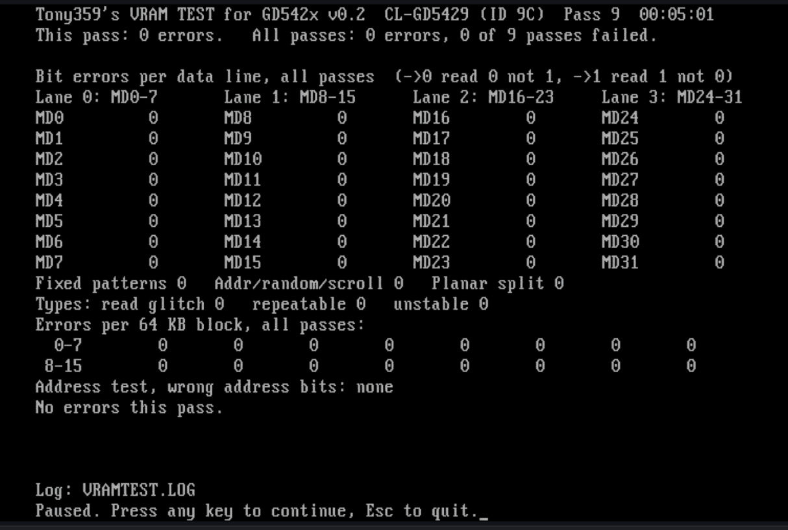
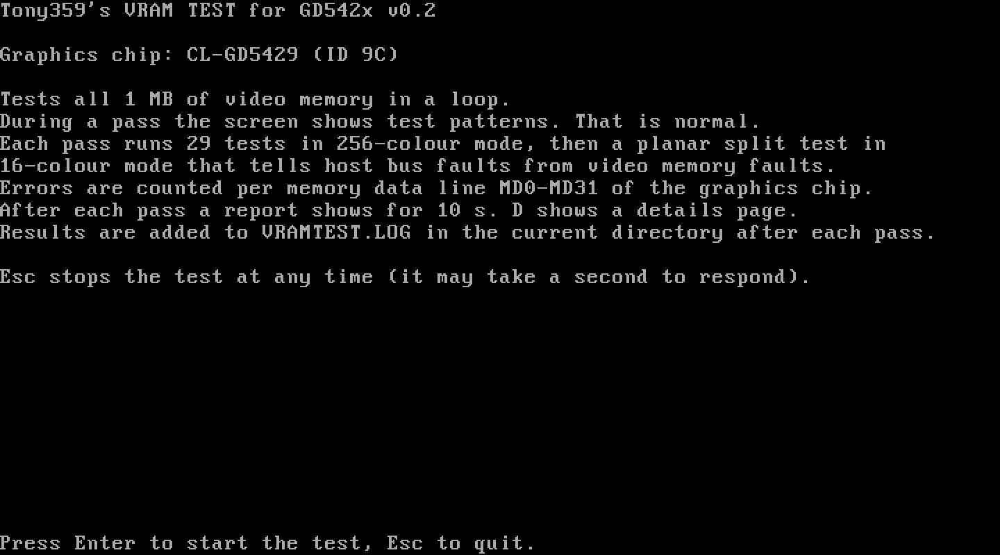
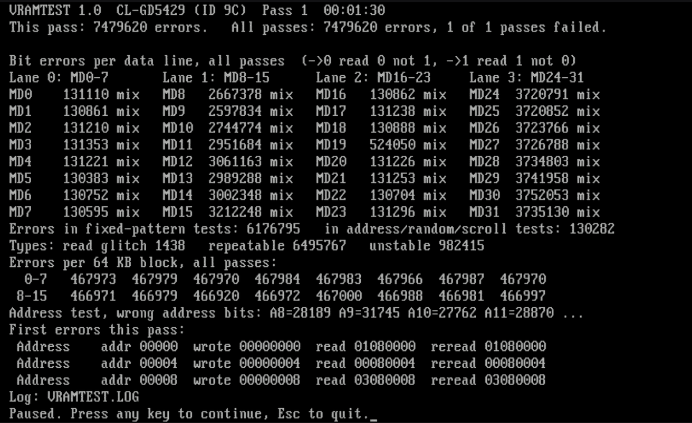
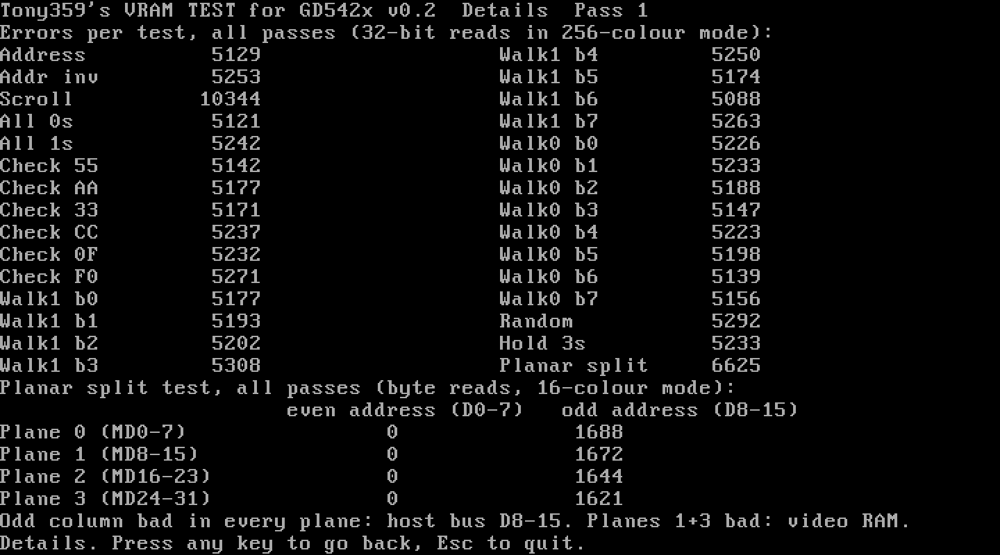

# Tony359's VRAM TEST for GD542x

A DOS tool that tests all 1 MB of video memory on **Cirrus Logic CL-GD542x** graphics cards and tells you *where* the fault is: which memory data line (MD0–MD31), which part of the memory, what kind of error, and whether the problem is in the video RAM or in the card's host data bus.



*Real capture: a CL-GD5429 VLB card after repair, 9 passes with zero errors.*

## Why

I wrote this while repairing a CL-GD5429 VLB card for my YouTube channel. CheckIt only said "BAD VIDEO PAGES", and DOS showed coloured blocks whenever the screen scrolled.

This tool showed millions of errors concentrated on the odd bytes (data lines MD8–MD15 and MD24–MD31), errors that changed between two reads of the same address, and a clean picture as long as nothing was read back. That pointed at the host data bus rather than the video RAM. The cause turned out to be one 74x245 bus transceiver socket with its direction pin (DIR) never soldered. After the fix: zero errors.

## Features

- Tests all 1 MB through the Cirrus 64 KB bank window. No VESA driver, no protected mode.
- 29 tests per pass: address-in-address, a scroll-like copy, fixed patterns, walking 1s and 0s, random data, and random data with a 3-second hold.
- Every wrong value is read a second time, so each error is classed as a **read glitch**, **repeatable** or **unstable**.
- Error counts per data line MD0–MD31, with the direction of each error (bit read 0 instead of 1, or 1 instead of 0).
- Error counts per 64 KB block and per test, and fixed-pattern errors kept apart from address-test errors (data faults versus addressing faults).
- **Planar split test**: separates faults on the card's host data bus from faults in the video RAM. See below.
- Runs in a loop with a report between passes, so you can watch a card fail as it warms up.
- Appends results to `VRAMTEST.LOG` after every pass, so you keep them even if the screen is garbled or the PC crashes.

## Requirements

- A Cirrus Logic CL-GD542x card with **1 MB** of video memory. Developed and used on a CL-GD5429 VLB card. Other GD542x chips (5422, 5424, 5426, 5428) use the same registers and should work, but are untested.
- A 386 or later CPU. The program uses 32-bit registers in real mode.
- DOS, booted clean without EMM386. Tested on MS-DOS 6.22.

## Download

Get `VRAMTEST.COM` from the [v0.2 release](https://github.com/Tony359/CirrusLogic-VRAM-Tester/releases/tag/v0.2) or from the [`bin`](bin) folder. [`bin/README.TXT`](bin/README.TXT) is a short DOS text version of these instructions.

## Usage

```
VRAMTEST        test the card
VRAMTEST /F     run even if the chip is not recognised as a CL-GD542x
```



*Intro screen. Rendered from an emulated card, with the VGA font from a real GD5429 BIOS.*

The program waits on the intro screen until you press **Enter**. Each pass then takes roughly 20–25 seconds on my 486 VLB system, and the screen shows test patterns while it runs. That is normal.

After each pass the report stays up for 10 seconds:

| Key | Action |
| --- | --- |
| Enter | Start the next pass now |
| D | Details page |
| Space | Pause |
| Esc | Quit (also stops a pass in progress) |

Results go to `VRAMTEST.LOG` in the current directory.

Only use `/F` on Cirrus cards. On other chipsets the memory banking does not work and the results are meaningless.

## Reading the report



*Real capture of the faulty card, first pass, taken with an earlier build (titled VRAMTEST 1.0). Almost all errors are on lanes 1 and 3, they go both ways ("mix"), and many change between two reads ("unstable").*

All counts are totals since the program started.

- **Bit errors per data line**: one count per wrong bit, for each memory data line of the graphics chip. Lane 0 = MD0–7, lane 1 = MD8–15, lane 2 = MD16–23, lane 3 = MD24–31.
  - `->0`: the bit always read 0 when 1 was written
  - `->1`: the bit always read 1 when 0 was written
  - `mix`: both directions happened, so the line is not simply stuck
- **Fixed patterns / Addr/random/scroll / Planar split**: errors in each group of tests. If the fixed patterns fail too, it is a data problem. If only the address/random/scroll tests fail, it is an addressing problem.
- **Types**:
  - `read glitch`: wrong on the first read, right on the second
  - `repeatable`: wrong twice in the same way
  - `unstable`: wrong twice, but differently
- **Errors per 64 KB block**: where in the 1 MB the errors are.
- **Address test, wrong address bits**: repeatable errors in the Address test where the value read belongs to another address. Data-line errors can show up here too, so only trust it when the fixed patterns are clean.
- **First errors this pass**: test name, address, value written, value read, value re-read.

Buzz the data line with the most errors from the graphics chip to its DRAM pin to find the chip.

## Details page and the planar split test



*Details page from an emulated card with a simulated host-bus fault: one bit flipping on reads at odd addresses. The errors sit in the odd-address column for every plane.*

The details page lists errors per test and the **planar split** table.

The planar split test runs in 16-colour mode, where the program chooses the memory plane separately from the CPU address. It writes and reads one byte at a time, one plane at a time, over the first 64 KB of each plane:

- On these 16-bit cards, **even CPU addresses** use the host data bus lines D0–D7 and **odd addresses** use D8–D15, whatever the plane.
- Each **plane** is one byte lane of video memory: plane 0 = MD0–7 … plane 3 = MD24–31.

So the table separates the two halves of the card:

| Pattern | Meaning |
| --- | --- |
| Errors in the odd column for every plane | Host data bus D8–D15: the graphics chip's host data pins, or the buffers (245s) that carry the odd bytes |
| Errors in the even column for every plane | Host data bus D0–D7 |
| Errors in both columns, but only for some planes | Video memory on those planes: data lines or DRAM chips |

## The tests

Each test fills all 1 MB, then reads it back.

| Test | Pattern |
| --- | --- |
| Address, Addr inv | Each 32-bit word holds its own address, then the inverse |
| Scroll | Copies each 64 KB block 256 bytes down, like a text-mode scroll (a read and a write per word), then checks it |
| All 0s, All 1s | 00000000, FFFFFFFF |
| Check 55/AA/33/CC/0F/F0 | Checkerboard patterns |
| Walk1 b0–b7 | One bit set in every byte |
| Walk0 b0–b7 | One bit clear in every byte |
| Random | Random data |
| Hold 3s | Random data, a 3-second wait, then the check |
| Planar split | 5 byte patterns per plane (55, AA, address mix, inverted address mix, random) at even and odd addresses |

## How it works

- **Main tests**: the BIOS sets mode 5Fh (640 × 480, 256 colours, packed pixels; VESA 101h as a fallback). The program then steps through the 1 MB in sixteen 64 KB banks at A000h, using the Cirrus offset register GR9 with 4 KB granularity. All accesses are 32-bit. Extended write modes, dual banking and 16 KB granularity are switched off in GRB, and the graphics controller is set to write mode 0 and read mode 0 with a full bit mask.
- **Lane assumption**: in packed 256-colour mode, the program assumes byte address L is stored in byte lane (L AND 3), so lane n is MD(8n)–MD(8n+7). If the data line it reports beeps to a chip that tests fine, the mapping may be different on that card.
- **Planar test**: mode 12h (640 × 480, 16 colours). The plane is chosen with the sequencer map mask (SR2) for writes and the read map select (GR4) for reads. All accesses are bytes, so each one uses only one half of the 16-bit host bus.
- **Log**: after every pass the program appends to `VRAMTEST.LOG`: elapsed time, error totals, the data lines and tests with errors, the planar split counts and the first few errors. The file is opened, written and closed each time.

## Building

Assemble with [NASM](https://www.nasm.us/) 2.x:

```
nasm -f bin -o VRAMTEST.COM src/VRAMTEST.ASM
```

The result is a single `.COM` file of about 7 KB with no dependencies.

## Testing

During development the program was run against an emulated GD5429: a CPU emulator with the Cirrus banking, planar mode and BIOS calls, plus deliberately injected faults. Each fault was reported as expected: a stuck data bit, random read glitches, a stuck address line, a fault confined to the top 64 KB, a host-bus fault on odd addresses, and a video RAM fault on lanes 1 and 3.

On real hardware it found the fault on the GD5429 VLB card described above, and showed it fixed afterwards: 9 passes with zero errors.

## Limitations

- Tests 1 MB. On a 2 MB card it tests the first 1 MB.
- Cirrus Logic CL-GD542x only.
- The lane mapping in 256-colour mode is an assumption (see above).
- The planar split test covers the first 64 KB of each plane (256 KB in total). That is enough to tell a host-bus fault from a video RAM fault, but it is not a full memory test.

## Licence

GPL-3.0. See [LICENSE](LICENSE).

## Credits

Written by Tony359, with help from Claude (Anthropic). Register details come from the Cirrus Logic *CL-GD542X Technical Reference Manual* (January 1994).
